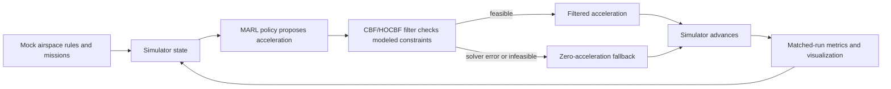

# UTM services startup — product and prototype plan

We are building a startup around software services for unmanned aircraft traffic management (UTM) and assurance. The product direction is real services that help operators and airspace stakeholders coordinate drone activity and manage traffic risk. We are starting with a simulation/API prototype so we can build and evaluate the core workflow before connecting it to live data, partners, or operations.

This repository currently contains the shared product and engineering plan and its supporting research report; owner briefs live on the three workstream branches. Implementation and measured results are still planned. The prototype is the first milestone in the startup’s product path, not the company’s end state. Real-service scope, operating domain, users, and deployment model must be decided and validated in the post-prototype product-definition phase.

## The problem we are exploring

As more drones share constrained airspace, each vehicle's motion can affect the options available to nearby vehicles. A learned policy may improve mission progress or traffic flow, but a learned action alone does not establish that separation will be maintained. We want to build a repeatable simulation in which a policy proposes actions, a model-based filter can modify those actions, and matched experiments show what the filter changes—including when it cannot produce a feasible action.

The first build is a **simulation/API demo**. A user should be able to configure synthetic airspace and missions, run a scenario, inspect the proposed and filtered actions, and compare measured outcomes across controller variants. Its API and registered vehicles are mock simulation interfaces. The product path after this milestone is to define the first real service, select its operating context and data sources, harden the service architecture, and then validate integrations through staged deployment gates.

## V1 workflow

The simulator owns ground-truth state. The policy receives the documented, deliberately simplified 18-value observation. The filter may alter the policy's proposed acceleration using the simulator's modeled state. If the filter fails or its optimization problem is infeasible, v1 emits a zero-acceleration command. That is an **unverified fallback**: it is not a hover controller and does not guarantee separation, especially when a drone already has velocity.

The shared simulation-only v1 data types, units, API routes, timing, logging, and error behavior are specified in [`INTERFACES.md`](./INTERFACES.md). That document is the contract for all branches. If code and contract differ, record the mismatch and resolve it through a change to `main` before treating either version as authoritative.

## V1 prototype scope

- A deterministic, seeded multi-drone simulation with configurable scenarios and disturbances.
- Mock API routes for synthetic airspace rules, notices, and drone registration.
- A deterministic reference controller, an unshielded MARL policy, and the same policy with a CBF/HOCBF filter.
- An explicitly unverified zero-acceleration fallback for solver errors or infeasible filter problems.
- Matched scenario comparisons over multiple seeds, with completion, separation, intervention, infeasibility, fallback, and latency measurements.
- A demo visualization/logging path and a model packaging and edge inference benchmark. Benchmark hardware and runtime must be named in the result; a CPU proxy must be labeled as a proxy.

These are planned deliverables. They are not claims that working implementations, performance numbers, or safety results already exist. V1 is intended to retire engineering and product questions that can be answered in simulation; it is not the startup’s complete service offering.

## Long-term research direction

The supporting report describes a broader layered architecture: strategic UTM intent and reservation coordination; tactical MARL or trajectory planning; CBF/HOCBF action filtering; a recoverability supervisor informed by Hamilton–Jacobi reachability; deterministic or independently validated backup behavior; and state-integrity, communication-trust, and conformance monitoring. This is a research direction, not the v1 architecture. V1 does not implement the full report architecture or inherit its possible assurance properties by using a simplified CBF filter.

Real sensor feeds, live USS/UTM integration, actual drone registration, operational flight use, hardware-in-the-loop, certification work, MPC, HJ reachability, and a verified backup controller are outside v1. These are potential later product and assurance milestones, with scope decided against a selected service and operating domain. A simulator chaos injector is a repeatable test input, not a defense against real attacks.

## From prototype to real services

The startup’s delivery path is staged so the first live service has a clear user, bounded role, and evidence behind it:

| Stage | Purpose | Exit condition |
| --- | --- | --- |
| **V1 simulation/API prototype** | Build and compare the core policy, filter, API, simulator, and evaluation workflow. | Reproducible demo and matched results with limitations documented. |
| **Service definition and readiness** | Select the first customer workflow and operating domain; decide whether the service provides information, coordination, operational advice, or control influence; define data provenance, integrations, availability, security, support, assurance, and validation requirements. | A reviewed service specification, bounded operating domain, production architecture, assurance plan, and staged validation plan. This is the next planning phase in [`TASKS.md`](./TASKS.md). |
| **Integration and limited deployment** | Build production connectors and service controls for the selected workflow; validate with recorded/replayed data and shadow operation before any permitted operational use. | Evidence and approvals required for the chosen operating context, with monitoring, incident handling, and rollback procedures defined. |
| **Operational services** | Deliver and support real UTM software services within the selected product role and operating domain. | Service reliability, security, operational ownership, and assurance obligations are met and reviewed for that deployment. |

The first real service may be an information or coordination service; whether it recommends or influences vehicle actions is a product and assurance decision, not an assumption embedded in the prototype. No stage authorizes flight operation by itself.

## Evaluation and evidence

Compare the deterministic reference, unshielded MARL, and shielded MARL on the same scenarios, traffic demand, dynamics, disturbance seeds, and episode limits. Report results over multiple paired runs and include uncertainty or run-to-run variation. Record at least mission completion and aborts, minimum pairwise separation, separation-violation samples, shield interventions, infeasible filter steps, fallback events, and simulation/policy latency. Do not use average reward as a safety measure.

Zero observed failures in a finite simulation campaign does not prove zero risk. A CBF/HOCBF safety claim is conditional on the model, initial conditions, control authority, uncertainty bounds, sample timing, and a feasible optimization problem. The v1 interfaces and fallback do not provide the report's full state-integrity or runtime-assurance architecture.

## Repository and ownership

`main` is the shared source of truth. The shared product and delivery plan is [`TASKS.md`](./TASKS.md), and v1 simulation contracts live in [`INTERFACES.md`](./INTERFACES.md). There is no `dev` documentation or integration step. Each workstream keeps its detailed owner brief on its named branch; its path is unique so a pull request does not replace this product README.

| Branch | Owner and responsibility | Owner brief |
| --- | --- | --- |
| `aman/infra-api` | **Aman** — product and system architecture, ML system design, integration, API/platform design, and platform-level scalability. The branch name understates this scope; it is not infrastructure work alone. | [`aman/README.md`](https://github.com/salmanbashashaik/drone-traffic-control/blob/aman/infra-api/aman/README.md) |
| `salman/cbf-safety` | **Salman** — MARL/ML algorithm research, mathematical foundations, CBF/HOCBF design, and the assumptions and limits behind safety claims. | [`salman/README.md`](https://github.com/salmanbashashaik/drone-traffic-control/blob/salman/cbf-safety/salman/README.md) |
| `anas/marl-policy` | **Anas** — simulator and scenario design, stress evaluation, and edge ML packaging and benchmarking. The branch name understates this scope; simulation and edge evaluation are part of the ownership. | [`anas/README.md`](https://github.com/salmanbashashaik/drone-traffic-control/blob/anas/marl-policy/anas/README.md) |

Each workstream sends pull requests directly to `main`. Before using an AI coding agent, read this README, [`TASKS.md`](./TASKS.md), [`INTERFACES.md`](./INTERFACES.md), and the owner brief on your branch. Keep changes within the assigned workstream, use the shared contract, identify assumptions, and summarize changed files, evidence, open issues, and handoff needs in the pull request. A change to a shared contract requires review from the affected owners and an update to every affected consumer.

## Supporting research

The [26-page report](./TLDR_Enterprise_UTM_MARL_Formal_Safety.1.pdf) is background research for the product direction. It synthesizes public material and proposed methods; it is not the startup’s product specification, an implementation record, vendor performance validation, or a report of new simulation, benchmark, or flight experiments. Its vendor analysis does not demonstrate this prototype's capabilities.

The report discusses CBF/HOCBF, MARL, reachability, and layered runtime assurance with explicit assumptions and open limitations. Use it as technical context while using the shared v1 contract to build the first milestone and the service-definition phase to decide what must change before real integrations and deployment.
