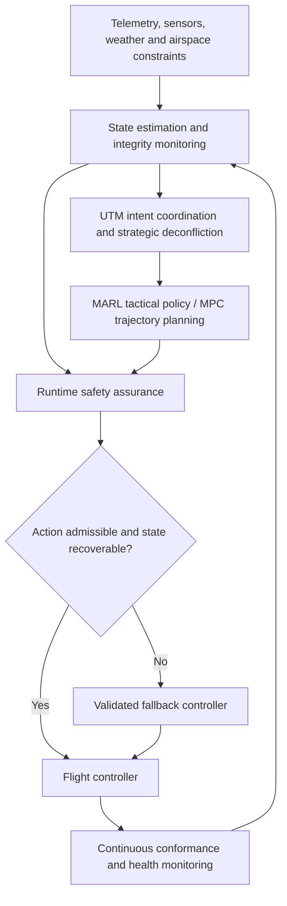

# Enterprise UTM Architecture & Formally Assured Multi-Agent Reinforcement Learning

A research report on Unmanned Aircraft System Traffic Management (UTM), multi-agent deconfliction, and the integration of learning-based coordination with formal safety methods.

**[Read the full PDF report]([TLDR_Enterprise_UTM_MARL_Formal_Safety (1).pdf](https://github.com/user-attachments/files/33637437/TLDR_Enterprise_UTM_MARL_Formal_Safety.1.pdf)
)**

## TL;DR

Current UTM systems coordinate, monitor, and deconflict drone traffic through information exchange, operational rules, and trajectory planning. **Multi-Agent Reinforcement Learning (MARL) could make coordination more adaptive, but it cannot independently guarantee aviation safety.**

The research investigates a hybrid architecture combining:

- **MARL** for efficient cooperative decision-making.
- **Model Predictive Control (MPC)** for trajectory optimization over a moving horizon.
- **Control Barrier Functions (CBFs)** for enforcing safety constraints under specified assumptions.
- **Hamilton–Jacobi (HJ) reachability** for assessing recoverability and supervising fallback behavior.
- **Runtime safety shielding and formal verification** for checking actions and establishing model-bounded guarantees.

The central research question is:

> Can formally constrained MARL improve airspace throughput and reduce delays compared with conventional UTM planning, while maintaining safety under dense traffic, uncertain trajectories, and communication failures?

This is a research hypothesis, not a demonstrated result of this repository.

## Report contents

The PDF opens with a two-page TL;DR and covers five core sections:

| Section | Topics |
| --- | --- |
| **1. Enterprise system decomposition** | Publicly documented Lockheed Martin and RTX capabilities; vehicle control, surveillance, USS interoperability, strategic planning, and tactical detect-and-avoid. |
| **2. Mathematical failure modes** | Combinatorial scaling, uncertain state estimation, communication latency, stale intent, wind disturbances, and conflicting decentralized decisions. |
| **3. MARL and organizational objectives** | Partial observability, cooperative policies, reward design, NASA research examples, inverse reinforcement learning, reward machines, and rulebooks. |
| **4. Safe RL and formal verification** | High-order CBFs, safety-filter optimization, HJ reachability, neural-network verification, and assurance limitations. |
| **5. Comparative evaluation and open frontiers** | Classical UTM versus end-to-end MARL versus shielded MARL; simulation, adversarial communication, scalability, and evaluation design. |

The report includes mathematical formulations, architecture diagrams, a comparative matrix, an evaluation protocol, and **32 linked references**.

## Documented capabilities vs. proposed architecture

The report distinguishes public product descriptions from proposed integration and algorithmic design.

| System | Publicly documented role discussed in the report |
| --- | --- |
| **Lockheed Martin VCSi** | Modular vehicle-control and mission-management software. |
| **Hydra Fusion Tools** | Geospatial information and data fusion. |
| **Skunk Works Project Hydra** | A communications and interoperability demonstration. |
| **RTX / Collins Aerospace Skyler** | Non-cooperative radar surveillance. |
| **STARS** | Terminal air traffic automation. |

These descriptions do **not** establish that the products share an end-to-end UTM stack or implement a particular MILP planner, MARL policy, or formal safety shield. The complete proprietary architectures and algorithms are not publicly disclosed in the reviewed evidence.

## Proposed reference architecture



This diagram is a **proposed research architecture**, not a vendor implementation. Runtime assurance may combine HOCBF filtering, HJ recoverability checks, and a validated fallback. Switching must occur early enough to account for sensing, computation, and actuation delays.

## Mathematical framing

A simplified learning objective is:

$$
\max_{\pi}\;\mathbb{E}\left[\sum_{t=0}^{T}\gamma^t R_t\right]
$$

A risk constraint may be expressed as:

$$
P(\text{collision}) \leq \epsilon
$$

Here, $\epsilon$ is an allocated design requirement, not a universal certification threshold. A chance constraint is distinct from a deterministic invariance guarantee.

For a control-affine model, a first-order CBF safety filter can be written as:

$$
u^* = \arg\min_{u \in \mathcal{U}} \frac{1}{2}(u-u_{\mathrm{RL}})^\top H(u-u_{\mathrm{RL}})
$$

subject to:

$$
L_f h(x) + L_g h(x)u + \alpha(h(x)) \geq 0.
$$

The set $\{x:h(x)\geq0\}$ defines the modeled safe region. Guarantees depend on initial conditions, model validity, feasible control authority, uncertainty bounds, and timely enforcement. Position-separation constraints with acceleration control generally require a high-order construction.

## Evaluation priorities

A credible comparison should use matched traffic demand, sensing, dynamics, computation budgets, and contingency rules. Relevant measures include:

- Throughput, delay, completion rate, and energy use.
- Minimum separation, loss of well clear, and near mid-air collision frequency.
- Tail decision latency and deadline misses.
- Safety-filter infeasibility and fallback intervention rate.
- Robustness to communication loss, uncertain trajectories, and uncooperative traffic.

High average reward and zero failures in a finite simulation campaign do not establish collision-free operation. The report discusses uncertainty intervals, stress testing, and unresolved proof obligations.

## Repository contents

```text
.
├── README.md
└── TLDR_Enterprise_UTM_MARL_Formal_Safety.pdf
```

Place both files in the same directory to keep the report link working.

## Scope and limitations

- This repository contains a **research document**, not an implemented UTM platform or flight-control system.
- No new simulations, hardware tests, flight experiments, or performance benchmarks were conducted for this report.
- The comparative matrix is qualitative and does not rank measured vendor performance.
- Standards discussions use public scopes, catalog entries, and supporting technical sources; full paid standards were not audited.
- Formal guarantees apply only within their stated models and operating assumptions. The report does not establish certification or operational approval.
- Research-potential assessments are qualitative judgments, not claims that a proposed method is novel or proven superior.

## Sources and provenance

The report was prepared from a user-supplied research text, with an opening TL;DR, technical qualifications, and independently located public references replacing unresolved citation markers. The original Deep Research citation database was not recovered.

The bibliography includes vendor documentation, FAA and NASA publications, ASTM and RTCA materials, and primary research on planning, reinforcement learning, and formal methods. Selected entry points:

- [FAA UTM Concept of Operations, Version 2.0](https://www.faa.gov/sites/faa.gov/files/2022-08/UTM_ConOps_v2.pdf)
- [NASA: Tactical Separation Assurance using Deep Reinforcement Learning](https://ntrs.nasa.gov/api/citations/20250002761/downloads/NASA-TM-20250002761.pdf)
- [Control Barrier Function Based Quadratic Programs for Safety Critical Systems](https://arxiv.org/abs/1609.06408)
- [Control Barrier Functions for Systems with High Relative Degree](https://arxiv.org/abs/1903.04706)
- [A General Safety Framework for Learning-Based Control in Uncertain Robotic Systems](https://arxiv.org/abs/1705.01292)
- [The Marabou Framework for Verification and Analysis of Deep Neural Networks](https://neuralnetworkverification.github.io/papers/cav2019-marabou)

See the PDF for the complete bibliography and claim-specific citations.

**Report edition:** 18 October 2026.
