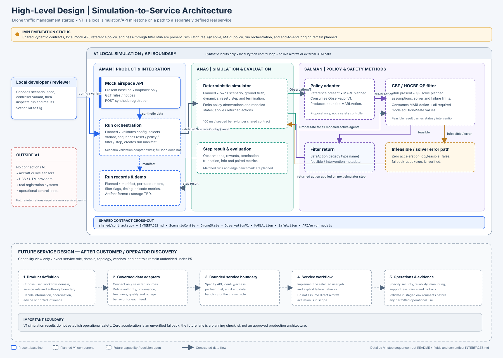

# High-Level Design: Simulation-to-Service Architecture

**Status:** V1 target architecture and service-evolution proposal. The V1 runtime is not yet fully implemented. This document does not authorize live integrations or operational use.

**Audience:** Aman, Salman, Anas, and AI coding agents working in this repository.

**Authority:** This HLD explains system boundaries, responsibilities, runtime placement, and the staged path toward a real service. The root [README data-flow diagram](../../README.md#v1-system-architecture-data-flow) remains authoritative for the V1 step flow. [`INTERFACES.md`](../../INTERFACES.md) and [`shared/contracts.py`](../../shared/contracts.py) remain authoritative for field names, units, validation, and error semantics. [`TASKS.md`](../../TASKS.md) remains the shared delivery plan.

## Architecture diagram

The editable source is [`HIGH_LEVEL_DESIGN.drawio`](./HIGH_LEVEL_DESIGN.drawio); [`HIGH_LEVEL_DESIGN.svg`](./HIGH_LEVEL_DESIGN.svg) is its matching static preview. Keep both files in sync when changing the diagram.

## 1. Purpose and scope

The startup is building software services for unmanned aircraft traffic management. V1 is an engineering and product-learning milestone: a repeatable simulation/API demo that lets the team configure synthetic airspace and missions, run controller variants, inspect policy-proposed and filter-returned actions, and compare measured outcomes.

The HLD separates three things that must not be conflated:

1. **The current repository baseline:** canonical Pydantic contracts, a local synthetic FastAPI mock API, and a scenario-validation adapter.
2. **The V1 target runtime:** Anas's simulator, Salman's policy and safety filter, Aman's orchestration/logging/demo, and matched evaluation. These components are still planned unless their implementation and evidence are merged.
3. **The later service direction:** a real service selected after prototype evidence and customer/operator discovery. Its user, domain, effect on operations, integrations, production topology, and assurance requirements are open decisions.

This design supports a path from prototype to real services by keeping component responsibilities and contracts explicit. It does not assume that the first service will control aircraft, that V1 outputs can be used operationally, or that a particular cloud, microservice, or deployment topology has been selected.

## 2. Design goals and non-goals

### Goals

- Make one V1 run traceable from validated scenario configuration to reproducible results.
- Keep simulator truth, policy observations, proposed actions, filtered actions, and run records distinct.
- Give each component one owner and a contract-defined handoff.
- Keep the control loop local and reproducible for the prototype.
- Preserve a clear path to add production integrations after the first service and its operating context are specified.
- Make planned work visible without describing it as implemented.

### V1 non-goals

- Live aircraft, sensor, USS/UTM, registry, or partner integrations.
- Operational advice or control influence, flight use, or a production deployment.
- Certified separation assurance or a verified fallback controller.
- Production identity, access control, availability, incident response, or security posture.
- The report's full strategic UTM, state-integrity, recoverability, HJ reachability, or deterministic backup architecture.

## 3. System context and trust boundaries

### V1 actors and systems

- **Local developer/reviewer:** chooses a scenario, seed, and controller variant; starts a local run; inspects logs and results.
- **Aman's mock API:** serves synthetic rules and notices and accepts synthetic registration requests. It is not an authoritative airspace source.
- **V1 control and simulation runtime:** runs in a local Python process. The application coordinates calls; the simulator owns state evolution; the policy proposes actions; the filter returns actions and status.
- **Local experiment outputs:** should retain enough configuration, version, and per-step data to reproduce and review a run. The exact artifact format and storage location are not yet selected.
- **External live systems:** aircraft, sensors, live airspace providers, USS/UTM services, and operational users are outside the V1 trust boundary and are not called.

The mock HTTP API is configured for loopback development at `127.0.0.1:8000`. The simulation/control runtime is a local process rather than a remote service. This is the current development deployment shape, not a production topology or a security design.

### Trust and authority

`ScenarioConfig` is user-supplied simulation input and must be validated at the boundary. `DroneState` is modeled simulator state; V1 does not establish that it represents trustworthy live sensor data. `ObservationV1` is a compact policy input, not a belief state. The policy's `MARLAction` is a proposal. `SafeAction` is the filter adapter's return type; the name does not establish real-world safety. Only synthetic IDs and mock airspace data are created by V1 API routes.

## 4. Logical architecture and ownership

| Component | Owner | Responsibility | V1 status in the repository |
| --- | --- | --- | --- |
| Canonical contract package | Shared | Pydantic v2 models used at component boundaries. No branch-local duplicates. | Present in `shared/contracts.py`. |
| Synthetic airspace/registration API | Aman | `GET /airspace/rules`, `GET /airspace/notam`, and `POST /drone/register`; explicit mock errors and in-memory registration. | Present as a local FastAPI baseline in `src/utm_services/api/app.py`. |
| Scenario adapter | Aman | Validate `ScenarioConfig` and pass that canonical model to a simulator reset boundary. | Present as an adapter protocol/helper in `src/utm_services/application/scenario_adapter.py`; it is not yet a complete run orchestrator. |
| Run orchestration and controller selection | Aman | Create run metadata, order reset/observe/policy/filter/step calls, and coordinate outputs. | Planned; no end-to-end run service is present yet. |
| Simulator and scenario engine | Anas | Ground truth, dynamics, seeded reset/step, termination, disturbances, and per-step simulator outputs. | Planned; implement under `src/utm_services/simulation/`. |
| Reference/MARL policy adapter | Salman | Consume `ObservationV1`, apply declared preprocessing/model metadata, and emit bounded `MARLAction`. | Planned; implement under `src/utm_services/policy/`. |
| CBF/HOCBF filter | Salman | Consume all modeled states required by the formulation plus proposed actions; return action and feasibility/intervention metadata. | Planned; implement under `src/utm_services/safety/`. |
| Run logger and results view | Aman | Record run manifest, per-step proposed/applied actions, filter outcomes, metrics, and artifacts for review. | Planned; output format and storage location remain to be chosen. |
| Matched evaluation and edge benchmark | Anas | Run paired scenarios, report distributions, package/benchmark policy inference, and preserve manifests. | Planned under `src/utm_services/evaluation/`. |

The one-repository layout and owner paths are documented in [`REPOSITORY_STRUCTURE.md`](./REPOSITORY_STRUCTURE.md). Component ownership does not grant permission to redefine shared fields or units.

## 5. V1 runtime sequence

The full step-level flow is shown in the root README. At HLD level, one run follows this sequence:

1. The local user selects a `ScenarioConfig`, seed, controller variant, and episode limit. Validate the configuration with the canonical Pydantic model before it reaches simulator code.
2. Aman-owned orchestration creates a run manifest containing scenario/configuration, seed, controller variant, episode limit, and code/model versions. It may request synthetic airspace data from the mock API.
3. The simulator resets from the validated scenario and returns initial policy observations plus metadata. It retains ground truth and owns transition, action application, and termination.
4. For each active controlled agent, the policy receives `ObservationV1` and emits one timestamp-matched, bounded `MARLAction`. The deterministic reference and unshielded/shielded variants must be separately identified.
5. The filter receives the proposed actions and the full set of modeled active `DroneState` values required by Salman's formulation. A feasible solve may pass through or modify the proposed actions and reports filter status.
6. If the joint filter problem is infeasible or the solver errors, the V1 fallback returns zero acceleration for the affected joint solve, with `qp_feasible=false` and `fallback_used=true`. The filter result goes back to the simulator, which applies it and advances one step.
7. The run layer records observations, modeled state where specified, proposed and returned actions, filter status, timing, and simulator results. At termination it aggregates the shared metrics and retains the run configuration and versions.

The application layer coordinates calls, but does not own simulator dynamics, policy math, or the CBF formulation. The control loop does not depend on the visualization. Exact models and required log fields are in [`INTERFACES.md`](../../INTERFACES.md).

## 6. Interfaces and data ownership

All shared boundary types come from [`shared/contracts.py`](../../shared/contracts.py). Current key handoffs are:

| Handoff | Contract types | Producer → consumer |
| --- | --- | --- |
| Local run setup → scenario engine | `ScenarioConfig` | Aman orchestration → Anas simulator reset |
| Simulator → policy | `ObservationV1` | Anas simulator → Salman policy adapter |
| Simulator → safety filter | `DroneState` for modeled active agents | Anas simulator → Salman filter |
| Policy → filter | `MARLAction` | Salman policy adapter → Salman filter |
| Filter → simulator | `SafeAction` | Salman filter/fallback → Anas simulator |
| Mock API request/response | `DroneRegisterRequest`, `DroneRegisterResponse`, `AirspaceRulesV1`, `NotamListV1`, `APIError` | Local client ↔ Aman mock API |

The v1 defaults in `INTERFACES.md` include 100 ms simulation steps, local Cartesian coordinates, a 5 m modeled pairwise separation threshold, bounded acceleration, and the `1e-4 m/s²` per-component intervention tolerance. These are simulation contract assumptions, not aviation standards. Changes must be reviewed by affected producers and consumers and merged into `main` before dependent implementations use them.

## 7. Deployment and runtime view

### V1 development deployment

- **Mock HTTP API:** local FastAPI application, loopback-only at `127.0.0.1:8000`, one worker, in-memory registration state.
- **Run/control path:** target is one local Python process for orchestration, simulator, policy, and filter. In-process boundaries use canonical Python/Pydantic types; no network service is required between them.
- **Configuration:** a validated `ScenarioConfig`, chosen controller variant, and seed. Model artifact format/loader is still to be agreed by Salman and Anas.
- **Logs/results:** target outputs are reproducible run manifests, per-step records, and episode summaries. The persistence technology and artifact layout are open implementation choices; do not imply durable storage already exists.
- **Packaging:** Python package structure is established. Deployment automation, containerization, cloud hosting, multi-user access, and production operations are not part of V1.

This topology intentionally keeps prototype integration easy to inspect. It makes no throughput, availability, isolation, or production-readiness claim. Aman's platform characterization task must name its workload and test environment.

### V1 architecture decisions

| Decision | Rationale | Constraint / revisit point |
| --- | --- | --- |
| Keep the simulation, policy, filter, and run coordination in one local Python process for the first vertical slice. | Makes the control path reproducible and easier to inspect while interfaces are still being integrated. | No production isolation, multi-tenant, or horizontal-scaling claim. Revisit after the first service workflow and workload are specified. |
| Keep the synthetic HTTP API separate from in-process control components. | Exercises a mock service boundary without putting network calls into each simulation step. | API is loopback-only, synthetic, and not a live UTM interface. |
| Use one canonical Pydantic contract package. | Prevents branch-local type drift and validates producer/consumer handoffs. | Contract changes require coordinated review and updates to `INTERFACES.md`. |
| Leave durable storage, cloud, containers, microservices, and production identity choices open. | The first service and its obligations are not selected yet. | Decide from P5 user, partner, regulatory, workload, and deployment evidence. |

## 8. Quality attributes and V1 responses

These are design constraints for the prototype, not claims that acceptance evidence already exists.

| Attribute | V1 design response | Evidence expected before claiming success |
| --- | --- | --- |
| Reproducibility | Seeded scenario reset, explicit controller variant, and versioned run configuration. | Repeat a run with the same code/config/seed and compare its transition sequence and recorded manifest. |
| Contract integrity | Validate boundary data with canonical `shared/contracts.py` models; reject malformed, stale, duplicate, or out-of-bounds actions instead of silently clipping them. | Contract shape/constraint tests and producer-consumer integration tests. |
| Inspectability | Record proposed and returned actions, filter status, scenario/seed, component versions, timing, and episode accounting. | A reviewer can trace a run and reproduce it from its stored inputs. Logger and artifact design remain planned. |
| Safety-claim discipline | Keep the policy, filter, and fallback outcomes separately labeled; include mathematical assumptions and infeasibility. | Salman reviews claims against the model and logged evidence. Simulation results are empirical evidence only, not proof of real-world safety. |
| Performance | Measure full-run, simulation-step, policy, and filter latency separately; Aman characterizes integration/platform resource use. | Report workload, hardware/software, warmup/sample counts, and distributions. No V1 latency or scale target is currently approved. |
| Failure visibility | Use shared API error envelopes; preserve aborted/incomplete run status; flag filter infeasibility and fallback events. | Tests and run artifacts show each error path and its effect on run accounting. |
| Production security and availability | Not designed or claimed for V1; local mock routes use synthetic data and loopback binding. | Define threat model, identity/access, reliability targets, operations, and independent review during service definition. |

## 9. Failure behavior and safety boundary

| Failure or condition | V1 behavior / design requirement | Owner |
| --- | --- | --- |
| Invalid API request | Return the documented `APIError` envelope with HTTP 422. | Aman |
| Duplicate synthetic registration | Return HTTP 409; do not contact a real registry. | Aman |
| Mock scenario data unavailable | Return HTTP 503 with the shared error envelope. | Aman |
| Unknown mock route | Return HTTP 404 with the shared error envelope. | Aman |
| Policy emits an invalid action | Reject it at the shared contract boundary; do not silently clip or reinterpret it. | Salman / integration owner |
| Filter infeasible or solver error | Emit the documented zero-acceleration fallback and explicit flags; log the event. It is unverified and may not maintain separation. | Salman |
| Run interrupted or incomplete | Preserve status and accounting so incomplete/aborted runs are not mistaken for successful missions. | Aman / Anas |
| Missing component or version metadata | Fail run setup visibly or mark metadata unavailable; do not produce an untraceable result as reproducible evidence. | Aman |

The filter's CBF/HOCBF assumptions and proof limits belong to Salman. A feasible QP, a `SafeAction` object, or zero observed violations in finite simulation runs does not prove zero risk. Chaos injections are test scenarios, not defenses against real attacks.

## 10. Evolution toward a real service

The V1 component boundaries give the team places to add production capabilities, but they do not preselect those capabilities or a deployment architecture. `P5-AM-01` in [`TASKS.md`](../../TASKS.md) must first define the user, job, operating domain, service role, authoritative data, and stakeholders. The first service could provide information, coordination, advice, or control influence; that is an explicit product and assurance decision.

After that decision, the production design should evaluate and specify, as applicable:

- External data adapters with source authority, provenance, freshness, quality, and outage behavior.
- A bounded service API and identity/access model for its intended users and partners.
- Durable run/service state, audit records, retention, privacy, and data governance.
- Security threat model, secrets/configuration handling, dependency/update policy, and incident response.
- Availability, latency, capacity, observability, support ownership, recovery, and rollback targets.
- Assurance objectives, hazard analysis, independent review, and evidence requirements for the chosen effect on operations.
- Staged validation using replay, shadow operation, integration environments, and any hardware/field evidence required by the domain.
- Deployment topology selected from real workload, partner, regulatory, and operational constraints.

The lower band in the diagram is a **capability planning view**, not a committed production system. It deliberately shows no command path to aircraft and does not establish regulatory approval or permission to operate.

## 11. Decisions and handoffs still required

| Decision / handoff | Accountable owner | Needed before |
| --- | --- | --- |
| Confirm dynamics, deterministic reset behavior, concrete reset/step signatures, episode semantics, and scenario fields. | Anas | Aman wires the end-to-end run loop; Salman binds controller adapters. |
| Document the relative-state formulation, CBF/HOCBF constraints, solver inputs, bounds, timing assumptions, infeasibility behavior, and proof limitations. | Salman | Filter implementation and any safety-related claims. |
| Confirm policy preprocessing, model/version metadata, batch semantics, and filter result details against shared contracts. | Salman, with Anas and Aman | Integrated controller variants. |
| Select the V1 run entry point, manifest format, artifact location, and result inspection surface. | Aman, with team input | P2 integrated demo and matched evaluation freeze. |
| Define workload and environment for platform-level scalability measurement. | Aman | P4 platform characterization. |
| Select first customer workflow, service role, operating domain, data authority, deployment constraints, and required external stakeholders. | Aman, through discovery with the team | P5 production architecture and assurance/validation planning. |

## 12. Change control

The workstream branches are collaboration lanes in one repository. Each owner implements their assigned component and submits a pull request directly to `main`. Shared contract changes update `INTERFACES.md` and `shared/contracts.py` together, name affected producers and consumers, and receive their review. Keep the implementation, tests, and evidence in the repository; do not mark a phase gate complete from a diagram or AI-generated claim alone.

