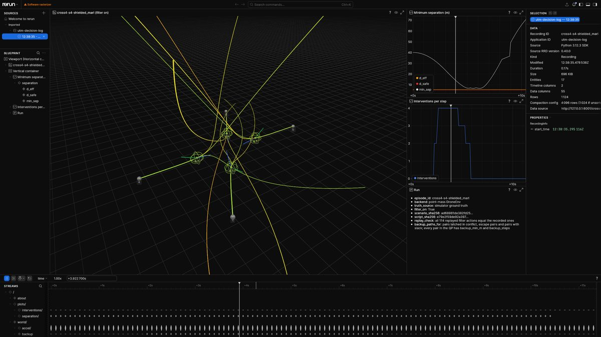
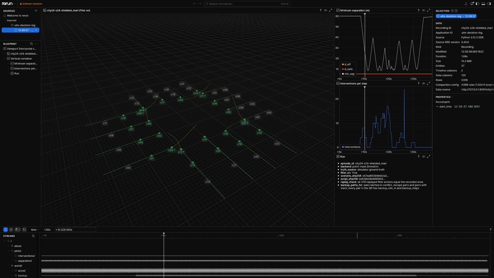
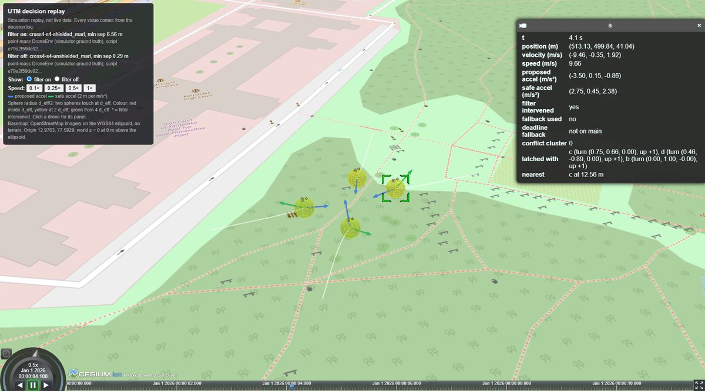
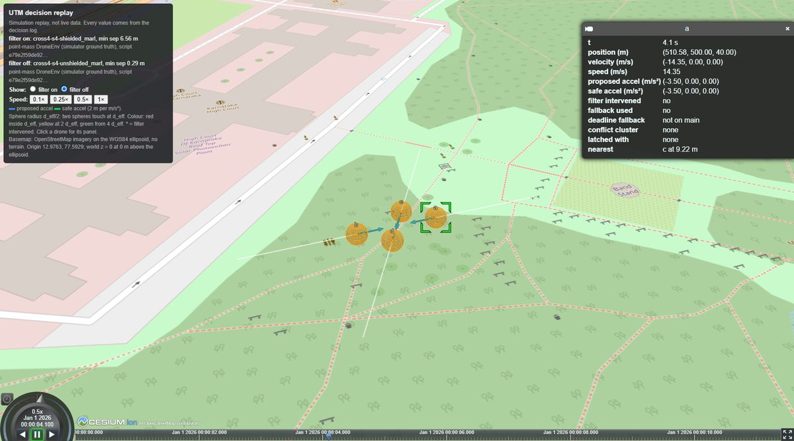
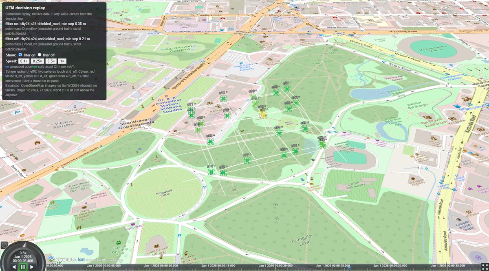
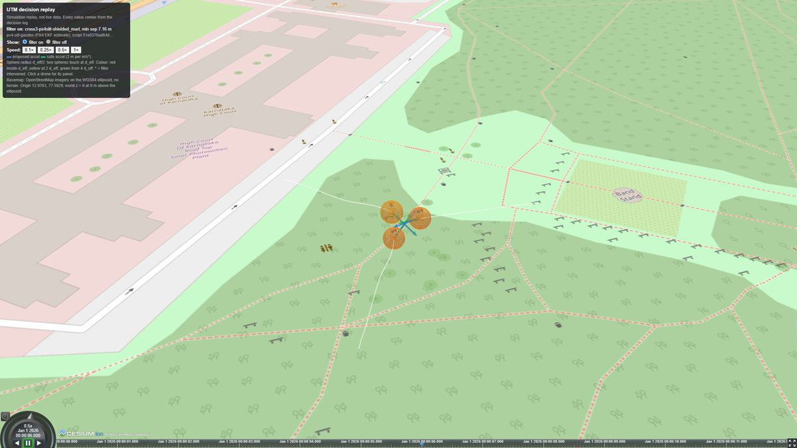

# Decision log and viewers

Two viewers draw one file, the decision log (`decisions.jsonl`), written next to a run's
`manifest.json`. Nothing in the log is estimated, smoothed or made up:

- Positions and velocities are the recorded truth: simulator ground truth for `utm-run`, the PX4 EKF estimate for `utm-px4-demo`, which has no ground truth.
- The proposed and safe accelerations are the recorded actions.
- The filter's internals are recovered by replaying `apply_filter` with the capture hook on the recorded filter inputs: conflict clusters, latch directions and backup manoeuvres. If any replayed action differs from the recorded one, no log is written.

These are simulation replays. They are not live data and not a flight claim.

## 1. Make the logs

From the repo root (venv active, `pip install -e ".[dev,plot,viz]"`):

```
utm-run scenarios/demo/cross4.json --variant shielded_marl   --out runs/demo/cross4-shielded_marl   --decision-log
utm-run scenarios/demo/cross4.json --variant unshielded_marl --out runs/demo/cross4-unshielded_marl --decision-log
```

Scenarios: `cross4`, `ring6`, `corridor5`, `city24` (24 drones on a 4 x 4 street grid). The two
variants run the same script, so their `script_sha256` values are equal. For a run made without
`--decision-log`, or for a PX4 run, write the log afterwards:

```
utm-decision-log runs/demo/cross4-shielded_marl
utm-decision-log runs/px4/cross3-filter-on
```

Each step of the log holds, per drone:

- true position and velocity;
- proposed and safe acceleration;
- `intervened`, `fallback_used` and `deadline_fallback` (always `null` on main: the solve deadline is contract v1.5);
- conflict cluster, latch directions, and the nearest neighbour with its distance. A cluster is a group of drones linked by pairs latched in conflict at that step, not every pair in the QP; a drone with no latched pair has cluster `null`.

Per pair in the QP it holds the separation, `d_eff`, the backup's minimum separation and its
length. The backup trajectory is stored for pairs latched in conflict, escape pairs and pairs
with slack. The header carries the scenario and script hashes, the code version of the run and
of the log, and the replay check.

The log uses two frames, listed in the header field `frames`. Positions, velocities,
separations and nearest neighbours are truth. Backup paths, backup minima, latches and
clusters are computed from the observed state the filter received. Without noise (`ideal`)
they are the same. The replay checks the filter's outputs; the truth fields are copied from the
record and not checked.

## 2. Rerun

```
utm-viz-rerun runs/demo/cross4-shielded_marl                  # opens the Rerun viewer
utm-viz-rerun runs/demo/cross4-shielded_marl --save cross4.rrd # or write a recording
rerun cross4.rrd
```

The view shows:

- drones with 15 s trails;
- spheres of radius d_eff/2, so two spheres touch at d_eff, coloured by the distance to the nearest neighbour (red inside d_eff, yellow at 2 d_eff, green from 4 d_eff);
- proposed (blue) and safe (green) acceleration arrows, 2 m per m/s²;
- backup trajectories, coloured by their minimum separation. They are computed from the state the filter received (the observed state). Under the `nominal` and `realistic` profiles this differs from the true position, so the first segment can jump;
- plots of minimum separation (with d_safe and d_eff) and of interventions per step;
- a run panel with the hashes.

Scrub with the timeline at the bottom. `*` after a drone id marks a filter intervention, `FALLBACK` a step that used the evasive fallback after a solver error.

## 3. CesiumJS

```
utm-viz-cesium runs/demo/city24-shielded_marl runs/demo/city24-unshielded_marl --out runs/demo/city24-cesium --serve
```

Then open http://127.0.0.1:8002/. The command writes `on.czml`, `off.czml`, `index.html` and
`manifest.json`, and `--serve` serves them on 127.0.0.1 only. It refuses two runs with different
`script_sha256`. With a single log the other toggle option is disabled. This is the case for PX4: a
`utm-px4-demo --filter off` run flies the drones at other altitudes, so its script differs from
the filter-on run.

The page shows:

- drones (quadcopter icons) with trails;
- the same spheres and arrows as Rerun;
- a click panel per drone with the step's values;
- Cesium's timeline, at half speed by default, with 0.1x to 1x buttons;
- a filter on / filter off toggle.

**Placement.** World point (500, 500, 0) sits at a fixed origin, by default Cubbon Park, Bengaluru (12.9763, 77.5929) at the WGS84 ellipsoid. Change it with `--origin LAT,LON[,H]` (write `--origin=-12.9,77` for a negative latitude). The mapping is an exact east-north-up rotation, so distances on the globe equal the logged ones. The origin is in `manifest.json`.

**Basemap and keys.** Keys come only from environment variables. `--serve` reads them at request time and answers them from memory at a random path that only the `index.html` it serves names, so no key is ever written to disk. It answers only requests addressed to `127.0.0.1:<port>` or `localhost:<port>`, so another web page cannot load the keys, also not through DNS rebinding. Never put a key in a file in this repo. A Google key used in a browser is visible to that browser, so restrict it by HTTP referrer in the Google Cloud console.

| Basemap | Needs | Choose with |
|---|---|---|
| Cesium World Terrain + Cesium OSM Buildings | `CESIUM_ION_TOKEN` | default when the token is set |
| Google Photorealistic 3D Tiles | `GOOGLE_MAPS_API_KEY` | `--basemap google` |
| OpenStreetMap imagery on the ellipsoid, no terrain | nothing | default without a token |

Credits are shown on screen. In Google mode the tiles are created with `showCreditsOnScreen`, as Google's policies require, and the panel says which parts are Google data and which are this replay.

**Google 3D Tiles coverage.** Google's coverage map (developers.google.com/maps/documentation/javascript/3d/coverage, updated 2026-10-21) showed no high-resolution coverage at Bengaluru or Hyderabad on 2026-10-24. London rendered as a control. This is why Google mode is not the default.

**Heights.** World z = 0 is placed at the origin height `H` (default 0, the ellipsoid). With World Terrain the ground at Bengaluru is several hundred metres above the ellipsoid. Pass the ground height as `H`, or the drones fly inside the terrain; the page warns when a terrain basemap is used with `H` = 0.

## 4. Screenshots

Headless Chrome captures of the pages above (OpenStreetMap basemap, no keys set), 2026-10-24.

| | |
|---|---|
|  Rerun, cross4, filter on |  Rerun, city24, filter on |
|  Cesium, cross4, filter on |  Cesium, cross4, filter off (same script) |
|  Cesium, city24, filter on |  Cesium, PX4 SITL cross3, filter on (EKF states) |
