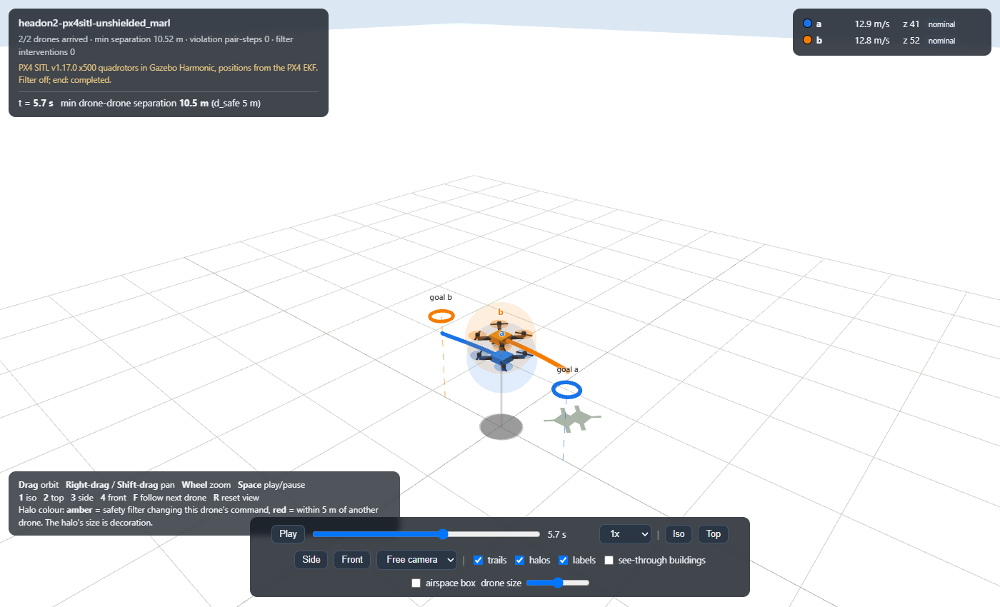
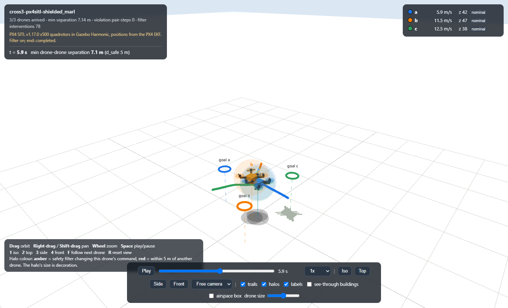
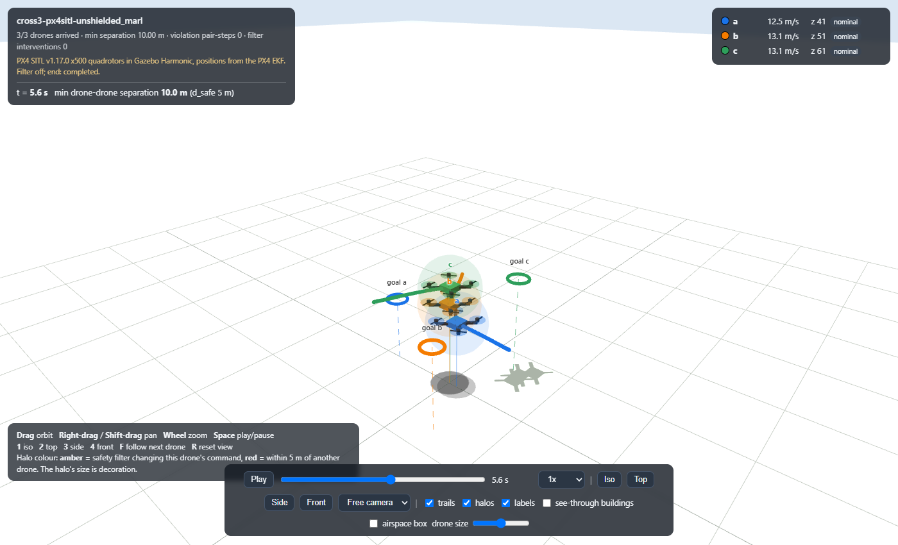
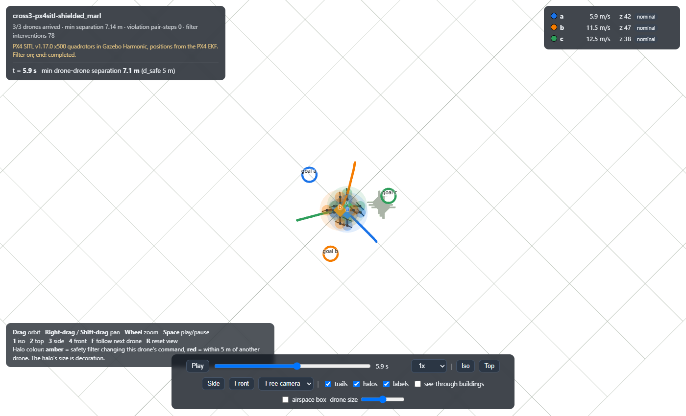

# PX4 SITL bridge: setup, commands and results

This is the first demo with real autopilot software. Two or three PX4 SITL x500 quadrotors fly in one
Gazebo Harmonic world. Our safety filter (the backup-set barrier filter) guides them live through `src/utm_services/integration/px4_bridge.py`,
through a head-on (`headon2`) and a three-way crossing (`cross3`).

Everything below was run on Windows 11, 6 cores, Quadro P1000 4 GB, WSL2 Ubuntu 24.04.1, headless
Gazebo (no GUI). The scripts start at most 3 PX4 instances. The committed results (section 10) were run on an idle machine
with no other jobs, one SITL session at a time.

Versions (pinned):

| Component | Version | Where it is pinned |
|---|---|---|
| PX4-Autopilot | `v1.17.0` (latest stable tag on 2026-10-24) | `git clone --branch v1.17.0`, recorded in every run manifest |
| Gazebo | Harmonic, gz-sim 8.15.0 (`gz-harmonic` 1.0.0-1~noble) | apt |
| MAVSDK-Python | 4.0.6 | `pyproject.toml` extra `px4` |
| Python (WSL venv) | 3.12.3 | `~/dtc-px4-venv` |

## 1. WSL2 and Gazebo Harmonic

On this machine WSL2 Ubuntu 24.04 and Gazebo Harmonic were already installed, so steps 1.1 and 1.2 were not
re-run. They are the standard commands.

1.1 WSL2 Ubuntu 24.04 (PowerShell as administrator, then reboot):

```powershell
wsl --install -d Ubuntu-24.04
```

1.2 Gazebo Harmonic from the OSRF apt repository (inside Ubuntu):

```bash
sudo apt-get update && sudo apt-get install -y curl lsb-release gnupg
sudo curl https://packages.osrfoundation.org/gazebo.gpg --output /usr/share/keyrings/pkgs-osrf-archive-keyring.gpg
echo "deb [arch=$(dpkg --print-architecture) signed-by=/usr/share/keyrings/pkgs-osrf-archive-keyring.gpg] http://packages.osrfoundation.org/gazebo/ubuntu-stable $(lsb_release -cs) main" \
  | sudo tee /etc/apt/sources.list.d/gazebo-stable.list > /dev/null
sudo apt-get update && sudo apt-get install -y gz-harmonic
gz sim --version      # Gazebo Sim, version 8.15.0
```

## 2. PX4 v1.17.0

```bash
git clone --branch v1.17.0 --depth 1 --recurse-submodules --shallow-submodules -j4 \
  https://github.com/PX4/PX4-Autopilot.git ~/px4-v1.17.0
cd ~/px4-v1.17.0
bash ./Tools/setup/ubuntu.sh --no-nuttx   # build dependencies; already installed here, not re-run
nice -n 19 make px4_sitl j=4              # 4 of 6 cores; took 4 min 51 s
git describe --tags                       # v1.17.0
```

`scripts/px4/sitl.sh` looks for PX4 in `~/px4-v1.17.0`; set `PX4_DIR` to use another checkout.

## 3. Python environment (inside WSL)

The repository is used in place from the Windows checkout (`/mnt/c/...`).

```bash
python3 -m venv ~/dtc-px4-venv
source ~/dtc-px4-venv/bin/activate
cd /mnt/c/Users/<you>/Desktop/dtc-px4        # this repository
pip install -e ".[dev,plot,px4]"              # px4 extra = mavsdk==4.0.6
pytest tests/test_px4_bridge.py               # 10 tests, no PX4 needed
```

From Git Bash on Windows, run a WSL command with `MSYS_NO_PATHCONV=1 wsl -d Ubuntu -- bash <script>`.
Without `MSYS_NO_PATHCONV=1`, Git Bash rewrites `/mnt/c/...` arguments.

## 4. Starting SITL

```bash
scripts/px4/sitl.sh start "0,0"                     # one x500 at the Gazebo origin
scripts/px4/sitl.sh start "-40,0" "40,0"            # two, 80 m apart
scripts/px4/sitl.sh start "40,0" "-20,34.641" "-20,-34.641"   # three, cross3 spawns
GUI=1 scripts/px4/sitl.sh start "0,0"               # also opens the Gazebo client
scripts/px4/sitl.sh stop
```

Spawn poses are in the Gazebo world frame (ENU, metres). Instance i gets `MAV_SYS_ID` i+1. It sends its offboard
MAVLink stream to UDP 14540+i and its ground-station stream to UDP 14550, from local port 18570+i (PX4 multi-vehicle defaults).
Instance 0 starts the Gazebo server and the others attach to it. The script refuses more than 3 vehicles (CPU budget). It
deletes `rootfs/<i>/parameters.bson` before each start, so every run starts from PX4 defaults. Logs go to `/tmp/dtc-px4-sitl/`.

## 5. One drone takes off

```bash
scripts/px4/sitl.sh start "0,0"
python scripts/px4/takeoff_check.py
scripts/px4/sitl.sh stop
```

Output on this machine: health OK at 0.4 s; first arm attempt `COMMAND_DENIED`, retried; above 9.5 m at 14.3 s;
hover at NED (0.02, 0.01, −9.91); landed at 31.3 s; disarmed at 33.3 s; `takeoff check passed`.
PX4 denies arming until it has seen the ground station's heartbeat for a moment, so the bridge and the check script retry arming (the bridge for up to 20 s).

## 6. Frames

| | x | y | z | origin |
|---|---|---|---|---|
| Ours (`shared.contracts`) | east | north | up | world box corner |
| PX4 local NED, per vehicle | north | east | down | that vehicle's spawn point (PX4 SITL sets the GPS origin where the vehicle boots) |
| Gazebo world | east | north | up | world origin |

One shared origin for every vehicle:

```
x = 500 + spawn_e + east
y = 500 + spawn_n + north
z = -down + 20            (ALT_OFFSET_M)
```

- `WORLD_ORIGIN_XY = (500, 500)` puts the Gazebo origin inside our world box.
- `ALT_OFFSET_M = 20` maps the SITL ground to z = 20, so our world floor (z = 30 m) is 10 m above the SITL ground, and our
  cruise altitude z = 40 m is 20 m above it. The offset is explicit in the code and in every manifest (`frame`).
- Velocities and accelerations rotate without an offset: (east, north, up) = (v_e, v_n, −v_d).

`check_shared_origin` compares each vehicle's frame with vehicle 0's before takeoff. Horizontal: the GPS origin offset, converted
to metres, must match the spawn offset. Vertical: while all vehicles stand on the flat ground, their local `down` must agree. The 3D
error must stay within `ORIGIN_TOLERANCE_M = 0.25 m` per vehicle, so two vehicles' frames can differ by at most 0.5 m. That is the whole
filter margin: at the limit no margin is left. Otherwise the demo stops before takeoff. Measured errors: 0.12 to 0.155 m (`origin_check_errors_m` in each manifest).

## 7. Setpoint mapping

Every 100 ms the bridge sends each vehicle a PX4 offboard velocity setpoint and an acceleration feedforward, both in NED:

```
v_cmd = v_meas + a_safe · dt          (dt = 0.1 s)
if |v_cmd| > 15 m/s: v_cmd scaled down to 15 m/s, direction kept
acceleration feedforward = a_safe
```

**Why the clip.** `MAX_SPEED_MPS = 15` in `shared.contracts` is the speed limit the filter and `DroneEnv` assume
(`DroneEnv` caps speed the same way). A faster setpoint would ask PX4 for a state the filter's model cannot be in. The
filter's own output stays within `MAX_ACCEL_COMPONENT_MPS2 = 3.5` per axis, so the acceleration needs no clip. In the runs the
speed cap never triggered (`speed_cap_events` 0). PX4 clips harder than we do, see "Known mismatches".

**Why the feedforward (deviation from the plain v + a·dt mapping).** At PX4's default velocity gain (`MPC_XY_VEL_P_ACC` 1.8),
a velocity setpoint only dt·a ahead of the measured velocity realises a small part of the commanded acceleration.
`scripts/px4/accel_tracking.py` flies +3.5 m/s² east for 2 s, then −3.5 m/s² for 2 s, at 10 Hz, and measures the realised mean
acceleration from PX4's velocity estimate:

| Mapping | PX4 params | +3.5 phase, whole / last 1 s | −3.5 phase, whole / last 1 s |
|---|---|---|---|
| velocity v_meas + a·dt | defaults (`MPC_ACC_HOR` 3.0) | 13 % / 15 % | 10 % / 13 % |
| integrated velocity v_prev_cmd + a·dt | defaults | 71 % / 99 % | 40 % / 94 % |
| velocity v_meas + a·dt + accel feedforward | defaults | 73 % / 77 % | 84 % / 96 % |
| velocity v_meas + a·dt | `MPC_ACC_HOR=5.0` | 14 % / 16 % | 10–11 % / 13–14 % |
| integrated velocity v_prev_cmd + a·dt | `MPC_ACC_HOR=5.0` | 71–72 % / 98 % | 40–41 % / 94 % |
| velocity v_meas + a·dt + accel feedforward | `MPC_ACC_HOR=5.0` | 66–71 % / 76–78 % | 81–83 % / 95–96 % |

(One run with defaults, two with `MPC_ACC_HOR=5.0`; ranges show both. Output: `docs/results/px4/accel-tracking/`.) The plain
mapping makes the filter's barrier assumptions false by a factor of 6 to 10. The integrated-velocity mapping tracks well when
steady, but on a reversal it realises 40 to 41 %, and it drifts from the measured state. The feedforward mapping keeps
v_meas + a·dt and realises 66 to 96 %, so the bridge uses it. The demos run with PX4 defaults (`MPC_ACC_HOR` 3.0).

```bash
scripts/px4/sitl.sh start "0,0"
python scripts/px4/accel_tracking.py                       # PX4 defaults
python scripts/px4/accel_tracking.py --set MPC_ACC_HOR=5.0
```

**Tracking during the encounters.** Computed from the filter-on records (realised acceleration from consecutive EKF velocities,
divided by dt, against `a_safe` of the step before):

| Run | RMS \|a_real − a_cmd\| (m/s²), all / shield-active steps | Realised fraction where \|a_cmd\| > 1 m/s², p10 / p50 / p90 |
|---|---|---|
| headon2 | 1.36 / 1.49 (n = 42) | 0.47 / 0.82 / 1.19 (n = 205) |
| cross3 | 1.45 / 1.87 (n = 78) | 0.51 / 0.86 / 1.17 (n = 321) |

So in flight PX4 realises a median of 82 to 86 % of the commanded acceleration, and 1 in 10 steps realises about half or less
(p10 47 to 51 %).
The filter config used here has `lag_s = 0`, so it assumes the plant applies a_safe at once. That assumption is not true for PX4.
The runs kept their separation margin anyway; this is a measurement on two encounters, not a bound.

## 8. The control loop

`run_encounter` runs one 100 ms step:

1. Read the latest telemetry snapshot of every vehicle (MAVSDK `position_velocity_ned` at 50 Hz). Abort if any is
   older than `TELEMETRY_STALE_MS = 500`.
2. Convert to `DroneState` in our frame (section 6).
3. Run the reference policy (`ReferencePolicy` through `run_policy`) on each drone's observation (`ObservationV1`, built as
   `DroneEnv` builds it; `tests/test_px4_bridge.py` checks equality).
4. Run `apply_filter` on all drones with one persistent latch for the whole run (filter on). With the filter off, a_safe = the proposal.
5. Send each vehicle its setpoint (section 7). Before each send, abort if the oldest telemetry plus the time since the
   step began exceeds 500 ms. A stall inside the step (filter solve, numba compile, GC, WSL scheduling, a blocking send)
   then lands the vehicles instead of sending a setpoint computed on old state. A stall between two sends of one step
   leaves the earlier vehicles with this step's setpoint; the end reason names them.
6. Append one record in the `records.jsonl` format `utm-run` writes, plus bridge fields per agent: `telemetry_age_ms`,
   `loop_latency_ms`, `flight_mode`, `v_cmd_ned_mps`, `speed_capped`.

A drone that reaches its goal (2 m) holds position and stays in the filter input, so the others still avoid it.
Steps run on a fixed 100 ms schedule without catch-up: a step that starts more than 500 ms late stops the run (this catches
sleep overshoot; step 5 catches stalls inside a step). The end reason is stored as `end_reason` in the last record. The first
cold `apply_filter` call compiles numba kernels (8.95 s in the first committed run, `filter_warm_up_s` in its manifest), so the
demo calls `warm_up_filter` with the run's number of drones before takeoff (0.33 to 0.36 s in the later runs, cache warm).
Any error, abort or Ctrl-C lands every armed vehicle.

`states` and `observed_states` in the records are the same PX4 EKF estimate: SITL gives the bridge no separate ground truth.
The minimum separations below are therefore EKF-to-EKF. The EKF error against Gazebo truth was not measured.

**Loop latency** is measured from the telemetry snapshot to the last setpoint sent (`time.perf_counter`).

## 9. Demos

```bash
source ~/dtc-px4-venv/bin/activate && cd /mnt/c/.../dtc-px4
utm-px4-demo headon2                 # filter on, writes runs/px4/headon2-filter-on/
utm-px4-demo headon2 --filter off    # each drone at its own altitude (40, 50 m), see below
utm-px4-demo cross3
utm-px4-demo cross3  --filter off    # 40, 50, 60 m
utm-px4-demo headon2 --out DIR       # other output folder
utm-px4-demo headon2 --no-launch     # use SITL already started with the same spawns
```

Each run starts SITL itself (`sitl.sh start` with the scenario's spawns), checks the shared origin, takes every vehicle
off to its start altitude, switches to offboard, flies the encounter, lands and stops SITL. Output: `manifest.json`
(versions, PX4 parameters, frame, origin check, filter config), `summary.json`, `records.jsonl` and `replay3d.html` (the
`utm-replay` 3D viewer; open it in a browser).

- `headon2`: two drones 80 m apart on the east axis at z = 40, with swapped goals.
- `cross3`: three drones on a 40 m circle, 120° apart at z = 40, each flying to the opposite point, so all three meet at the centre.
- `--filter off`: the unfiltered reference flies the same horizontal paths, but each drone flies 10 m above the previous
  one, so it cannot collide. These runs show the encounter is real: the horizontal separation goes to 0.81 m and 0.39 m.

## 10. Results (2026-10-24, committed under `docs/results/px4/`)

d_safe = 5 m, d_eff = d_safe + margin = 5.5 m.

| Run | Min 3D sep (m) | Min horizontal sep (m) | Violation pair-steps | Interventions | Fallbacks / infeasible | Loop latency p50 / p95 / max (ms) | Telemetry age p50 / p95 / max (ms) | Encounter |
|---|---|---|---|---|---|---|---|---|
| headon2, filter on | **8.53** | 4.42 | 0 | 42 | 0 / 0 | 4.80 / 7.48 / 37.95 | 13.20 / 18.83 / 18.94 | completed, 10.5 s |
| cross3, filter on | **7.14** | 1.37 | 0 | 78 | 0 / 0 | 5.27 / 10.34 / 16.75 | 16.19 / 16.39 / 20.38 | completed, 11.2 s |
| headon2, filter off, 40/50 m | 10.52 | 0.81 | 0 | – | – | 0.76 / 1.10 / 2.23 | 8.02 / 14.72 / 17.24 | completed, 10.0 s |
| cross3, filter off, 40/50/60 m | 10.00 | 0.39 | 0 | – | – | 0.87 / 3.69 / 5.74 | 10.67 / 19.75 / 30.22 | completed, 10.5 s |

- One run per configuration, on the final bridge code, on an idle machine (2026-10-24, 09:10 to 09:22 UTC).
- Neither filter-on run entered d_eff (time inside d_eff 0 s). The maximum step overrun of a filter-on run was 0.3 ms.
- The filter resolves both encounters mostly vertically. In headon2 the drones pass at about z = 38.5 and 45.8. In cross3
  drones b and c pass 1.4 m apart horizontally and 8.5 m apart in altitude.
- Each filter-on loop has p95 latency 7.5 to 10.3 ms (max 38 ms), well inside the 100 ms step.

Screenshots of `replay3d.html` at the closest approach (headless Chrome):

| | filter on | filter off |
|---|---|---|
| headon2 |  |  |
| cross3 |  |  |

cross3 filter on, from the top: 

Screenshot command (Windows, one Chrome profile per shot; `t` is the fraction of the replay):

```bash
timeout 60 chrome.exe --headless=new --user-data-dir=<tmp>/chrome-prof-X --enable-unsafe-swiftshader --use-angle=swiftshader \
  --hide-scrollbars --window-size=1400,850 --virtual-time-budget=4000 --screenshot=docs/integration/img/X.png \
  "file:///<repo>/docs/results/px4/headon2-filter-on/replay3d.html#t=0.577&pause=1&view=iso"
```

## 11. Link loss

PX4 on link loss: `COM_OF_LOSS_T = 1.0` s (offboard-loss timeout, default) and `COM_OBL_RC_ACT = 0` (action:
Position mode). Both values are recorded in every manifest under `px4_params`.

Test: run headon2 with the filter on, kill the bridge 3 s into the encounter without landing or leaving offboard, and watch PX4 from a second ground station:

```bash
scripts/px4/sitl.sh start "-40,0" "40,0"
python scripts/px4/link_loss_watch.py 2 80 > watch.log &       # own GCS (sysid 246) on UDP 14550; lands all at the end
utm-px4-demo headon2 --no-launch --stop-after 3 --out runs/px4/headon2-linkloss
wait; scripts/px4/sitl.sh stop
```

`--stop-after S` makes the bridge print the start time of its last step, then exit with `os._exit(3)`: no cleanup,
no offboard stop. Log: `docs/results/px4/headon2-linkloss/watch.log` (Unix times).

| Unix time (s) | Event |
|---|---|
| 1792833638.361 | last bridge step starts (`last_step_unix`); its setpoints leave within the loop latency (max 18 ms) |
| 638.520 | bridge process exits (`exit_unix`) |
| 639.635 / 639.639 | both vehicles: `CRITICAL: Failsafe activated` |
| 639.687 / 639.691 | both: `RTL: start return at 31 m (30 m above destination)` |
| 639.715 / 640.519 | heartbeat flight mode `RETURN_TO_LAUNCH` (heartbeats lag up to 1 s) |
| 654.26 / 654.68 | `RTL: land at destination` |
| 681.95 / 682.13 | `Landing detected` |
| 683.95 / 684.13 | `Disarmed by landing` |

Findings:

1. **The failsafe fired 1.27 s after the last fresh step and 1.12 s after the process exited.** While the bridge process
   lived (0.16 s here), MAVSDK's offboard plugin kept re-sending the last setpoint; PX4's 1.0 s timeout then ran from the last
   packet. PX4 cannot tell a re-sent setpoint from a fresh one. In those 1.27 s each drone flew about 11 m at up to 9 m/s on a
   command computed from old state. A bridge that hangs without exiting would keep a stale setpoint alive with no time limit.
   Docs: `PROTOCOL_NOTES.md`, validity windows.
2. **The action was Return-to-Launch, not Hold or Position.** `COM_OBL_RC_ACT = 0` means Position mode, which needs RC. SITL has no RC, so
   PX4 fell back to RTL. Both drones climbed to about 31 m (SITL height), turned back and landed at their own launch points. In head-on they flew apart,
   but in other geometries RTL paths could cross at the same return altitude. After link loss the filter is out of the loop.
3. In an earlier run of the same test, one vehicle also reported `Preflight Fail: Attitude failure (roll)` and a second
   `Failsafe activated` while turning into RTL at 8.6 m/s. It still landed.
4. After `Disarmed by landing`, the heartbeat flight mode reads `OFFBOARD` again (observed, not explained)
   and PX4 prints `Preflight Fail: heading estimate not stable`. Both are after landing.

The stop came 3 s into the encounter, while the drones were still 59 m apart (about 39 m when the failsafe fired). The test checks the failsafe timing and action, not
a failsafe during a near-miss.

## 12. Known mismatches between the filter's model and PX4

| Item | Filter / contracts | PX4 v1.17.0 defaults | Effect seen |
|---|---|---|---|
| Horizontal speed limit | 15 m/s | `MPC_XY_VEL_MAX` 12 m/s | EKF horizontal speed peaks 12.5 to 13.1 m/s; the filter may plan with speeds PX4 will not fly |
| Vertical speed | 15 m/s total | `MPC_Z_VEL_MAX_UP` 3, `MPC_Z_VEL_MAX_DN` 1.5 m/s | The filter's vertical escapes are capped; EKF peak \|v_z\| 3.2 m/s |
| Response lag | `lag_s` = 0 | velocity and attitude loops lag (whole-phase vs last-1 s gap, section 7) | median 82–86 % of a_safe realised, p10 47–51 % |
| Setpoint freshness | each step's command is new | MAVSDK re-sends the last setpoint until the process exits | Failsafe 1.27 s after the last fresh command |
| Link-loss action | none modelled | RTL (no RC in SITL) | Filter out of the loop; uncoordinated return paths |

None of these changes a threshold or the filter. Changing `lag_s` or the limits is a safety-config decision for the founder.

Findings filed as backlog items (`TASKS.md`):

- **BL-13: measured actuator lag.** PX4 realises a median 82 to 86 % of a_safe in flight, with p10 47 to 51 %. The filter models no lag (`lag_s` = 0). Linked to BL-05 and the adaptive-margin research (P3-SA-03).
- **BL-14: stale-command risk.** On link loss, MAVSDK keeps re-sending the last setpoint until the bridge process exits. PX4's failsafe came 1.27 s after the last fresh step (0.16 s of re-sends until exit, then the 1.0 s timeout). A bridge that hangs without exiting would keep the stale command alive with no limit.
- **BL-15: uncoordinated RTL.** Each drone that loses the link flies its own RTL with the filter out of the loop. Return paths of drones in the same conflict are not deconflicted.

## 13. Tests

```bash
pytest tests/test_px4_bridge.py
```

10 tests run without PX4 or MAVSDK: frame axes and offset, vector round trip, shared-origin check (pass, 0.3 m horizontal and
0.4 m vertical fail), the setpoint mapping and its clip, observation equality with `DroneEnv`, a full `run_encounter` on an ideal
fake fleet (record format, contract validation, `h_min_prev_m2` as `DroneEnv`, filter keeps d_safe), the stale-telemetry abort,
the abort on a 0.6 s stall before the first send (no setpoint sent), and on 400 ms telemetry age plus a 150 ms stall inside
the first send (the second vehicle gets no setpoint; 400 ms age alone completes).
